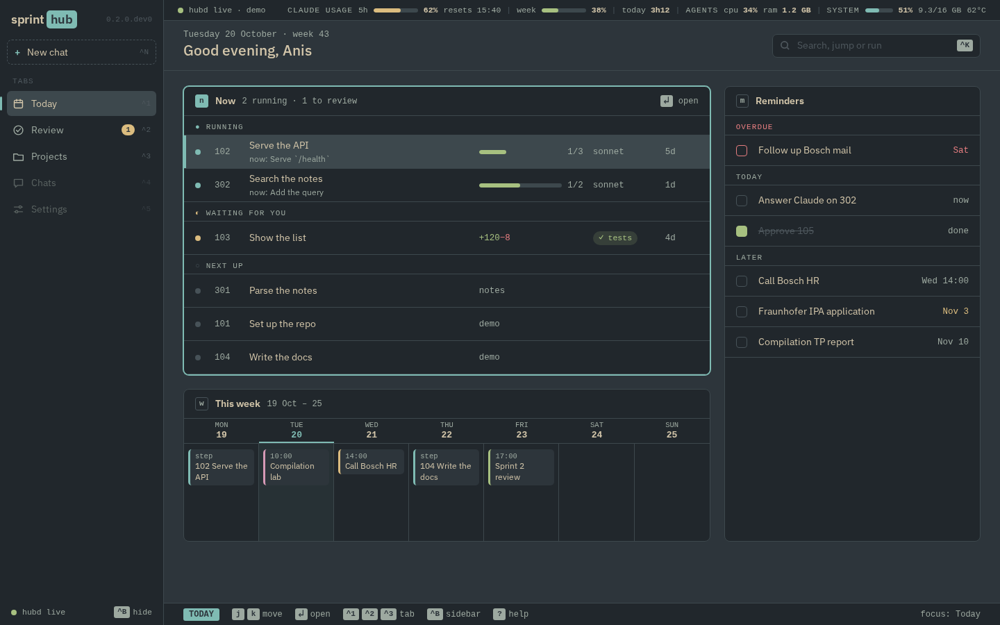
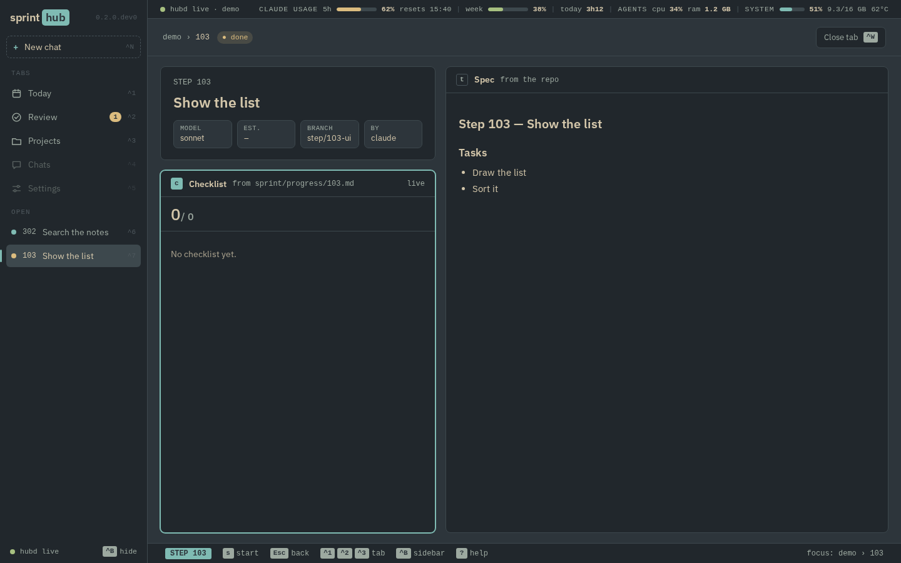

# sprint-hub

> **TODO(Anis): write the pitch in your own words (2–4 sentences).** Guiding questions:
> 1. What problem did you have that made you build this? Name one concrete moment.
> 2. ROADMAP rule 1 says lead with the system: an event-driven daemon, a state machine over plain markdown files,
>    and a human review gate before anything is merged. Do you agree with that order, or does something else come first?
> 3. What should a reader know after the first sentence, before they try the demo?

## Try it

Needs `uv` and Node 24. No Claude, Omarchy or your own projects needed: the demo runs on built-in data with a fake runner.

    cd web && npm ci && npm run build && cd ..   # once: builds the UI that hubd serves
    uv run hubd --demo

Open http://127.0.0.1:8765/. Keys: `1` Projects, `2` Today, `3` Review, `4` Questions, `5` Settings; `j`/`k` (or arrows)
walk a list, `h`/`l` move between columns, `Enter` opens, `Esc` goes back, `b` hides the sidebar, `Ctrl+K` or `/` opens
the command palette, `e` shows the errors. On the Step screen `s` starts a step and `f` finishes a run whose end never
arrived; on Review `a` approves and `c` requests changes. `?` shows all keys. A project opens on the step that needs
work, a step on its current task.

### Set it up on your own projects

In this order, from this repo:

1. List your projects in `~/.config/sprint-hub/projects.toml`:

       [[project]]
       name = "my project"
       path = "~/Projects/my-project"

2. `uv run hubd init` creates the vault (`~/Hub`, or `HUB_VAULT`) and `projects/my-project/` with its `project.md`
   and an empty `steps/`. Running it again changes nothing: a project already in the vault is never rewritten, and one
   you removed from `projects.toml` stays. A project whose path does not exist is skipped with a warning.
3. `uv run hubd import` writes one vault step per spec in each repo's `sprint/` (`uv run hubd import my-project` for one
   project). It reads the repos and writes only in the vault. A step from a closed sprint (`sprint/archive/`), or
   whose branch is already in a remote branch (pushed = reviewed), imports as `approved`; running it again also moves
   such a step from `todo` or `done` to `approved` and leaves every other step file as it is.
4. `uv run hubd install-hook` adds the SessionEnd hook to `~/.claude/settings.json`, so hubd hears when a run ends.
5. `uv run hubd install-service` runs hubd from login on (see below).
6. `uv run hubd doctor` checks all of the above; every line should be `✔`.

After that, a project added to `projects.toml` and a new spec in a repo's `sprint/` show up by themselves.

- **Deadlines**: one line each in `~/Hub/deadlines.md`, `- [ ] 2026-11-05 PFE report draft #school [[sprint-hub/301]]`
  (tag and step link optional, `[x]` = done). Today lists the next 7 days, overdue first in red.
- **Manual steps**: `by: me` in a step's frontmatter; its `## Tasks` are the checklist, `x` on the Step screen ticks one.
- **Questions**: an agent writes `- [ ] question` to `sprint/questions/<id>.md` in the repo; answer with
  `- [x] question → answer`. Key `4` opens the inbox of open ones.
- **Theme**: `hubd serve` takes the colours of the current Omarchy theme and follows a theme switch live.

### Open it as an app window

`bin/sprint-hub-app` starts `hubd` if it is not running, then opens sprint-hub in its own Chromium `--app` window
(no tabs, no URL bar), or focuses it if it is already open. On Omarchy (Hyprland), bind it in `~/.config/hypr/bindings.lua`:

    o.bind("SUPER + SHIFT + P", "Sprint hub", "/path/to/sprint-hub/bin/sprint-hub-app")

This runs the real `hubd` on your vault, not the demo. Closing the window leaves `hubd` running.

### Run hubd as a service

`uv run hubd install-service` writes `~/.config/systemd/user/hubd.service`, shows the diff, asks y/N, then enables and
starts it. hubd then runs from login on (reminders need that), restarts after a crash and logs to
`journalctl --user -u hubd`. `uv run hubd uninstall-service` undoes it; `bin/sprint-hub-app` still works without it.

- **`PATH`** is copied from the shell that runs `install-service` (so `claude` under mise is found). Run it again after
  `claude` moves. **`WAYLAND_DISPLAY`** and the other desktop variables are read from `systemctl --user show-environment`
  each time hubd opens a terminal or a notification.
- Port 8765 taken: hubd logs one line and exits with 98; the unit does not restart on 98.
- **`git switch` on this repo changes the code the service runs.** The unit points at this repo's `.venv/bin/hubd`; a
  branch with a broken hubd means a broken service. Restart it after a switch: `systemctl --user restart hubd`.

## Screenshots

> **TODO(Anis): retake these from the 0.2.0 build before the release, or drop them.**

## How it works

> **TODO(Anis): write the state-machine section in your own words.** Start from [docs/states.md](docs/states.md) (the diagram).
> Guiding questions:
> 1. Why may only the daemon move a step to `doing` and `done`, and only you to `approved` and `changes`?
>    What would go wrong if Claude could mark its own step `approved`?
> 2. Where does the source of truth live (the markdown files), and what happens to the state when hubd restarts?
> 3. What is the review gate for, in one sentence?

## Tests and CI

    uv run pytest                  # API, model, runner and hook tests; no Claude needed
    uv run ruff check              # lint
    cd web && npm run build && npm run e2e   # one browser test of the demo loop (Playwright)

The e2e test (`web/e2e/loop.spec.ts`) starts `hubd --demo` itself. `tests/fixtures/` holds anonymised samples of the
outside formats (the vault files, the Claude Code hook input), so a change in those formats shows up as a failing test.
CI (`.github/workflows/ci.yml`) runs all of the above on every push and pull request.

## Roadmap

Versions and scope: [docs/ROADMAP.md](docs/ROADMAP.md). Long-term design: [docs/HUB-DESIGN.md](docs/HUB-DESIGN.md).
Current version: 0.3.0 (daily use: theme, deadlines, questions, palette, service, weekly planning). Next: 0.4.0,
chat in the app, then 0.5.0, away from the laptop. The v1 Textual app is on `main` (tag `v0.1.0`).
