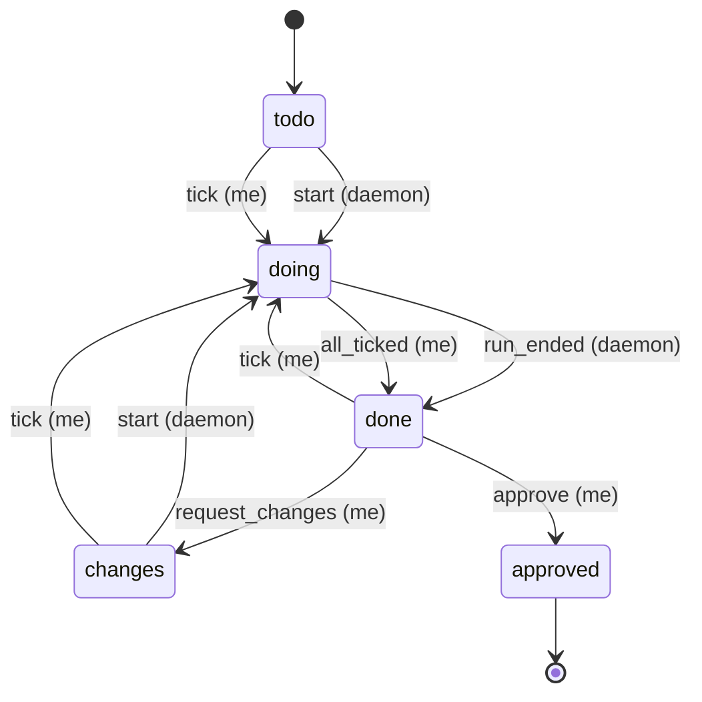

# Step states

Drawn by hand from `TABLE` in `src/hubd/states.py`. Each arrow is one row: `event (actor)`.
A move that is not an arrow here raises `InvalidTransition`.

`[*] --> todo` and `approved --> [*]` mark where a step begins and ends; they are not moves in the table.

## Manual steps (`by: me`)

hubd never runs a `by: me` step (`start` is a 409). Its checklist is the `## Tasks` section of its
vault step file (`projects/<project>/steps/<id>.md`), also when the project has a repo: the vault is
what syncs to the phone. `POST /steps/<project>/<id>/tasks/<n>/tick` toggles task `n` (0-based)
between `- [ ]` and `- [x]`. The first tick moves the step to `doing` (`tick`); when every task is
done it moves to `done` (`all_ticked`); unticking a task of a `done` step moves it back to `doing`.
Approve and request changes work as for Claude steps.

## Why the rules look like this

<!-- TODO(Anis): write this part in your own words. Guiding questions:
1. Why may only the daemon move a step to `doing` and `done`, and only you to `approved` and `changes`?
   What would go wrong if Claude could mark its own step `approved`?
2. Why is `blocked` not a state in this table, even though the UI will show blocked steps?
3. Why does `changes` go back to `doing` through `start`, and not straight back to `done`?
-->
